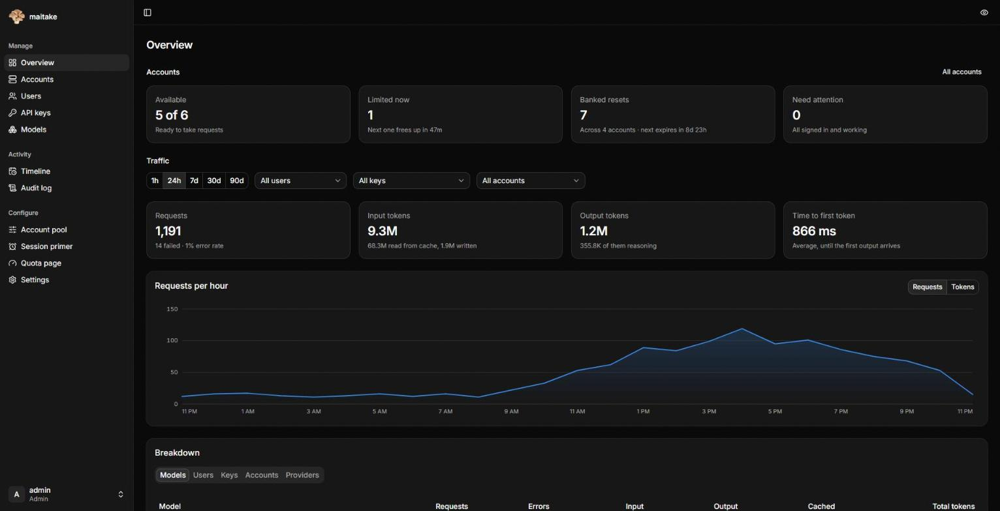

<p align="center">
  
</p>

<h1 align="center">maitake</h1>

<p align="center">
  <b>mai·ta·ke</b> · /maɪˈtɑːkeɪ/ · “my-TAH-keh”<br>
  <sub>舞茸, Japanese for the “dancing mushroom”</sub>
</p>

A multi-user proxy that serves AI subscriptions (ChatGPT, Claude and more) as Claude Messages, OpenAI Chat Completions and OpenAI Responses APIs, with a built-in admin dashboard. Inspired by [CLIProxyAPI](https://github.com/router-for-me/CLIProxyAPI).



- Per-user API keys with allowed models, rate limits and expiry
- Account pool with priorities, automatic failover, cooldowns and token refresh
- Live quota tracking for every account, including banked resets (view and redeem; Codex can also auto-redeem)
- Usage logging per user, key, model and account
- A self-serve quota page: anyone with a key can check the remaining limits and reset times themselves, showing only what the admin chose for that key
- Announced global resets from [claude-resets.com](https://claude-resets.com) and [codex-resets.com](https://codex-resets.com), plus upcoming and predicted Codex resets

## How it compares to CLIProxyAPI

CLIProxyAPI supports far more providers and is the better fit if you want all of them for yourself. maitake is built for one instance that several people share, managed entirely from the dashboard.

| | maitake | CLIProxyAPI |
| --- | --- | --- |
| Client keys | Per-user keys, each with its own allowed models, rate limits and expiry | A plain list of keys in `config.yaml` |
| Quota for key holders | Self-serve quota page per key, showing only what the admin allows | Only in the management panel, behind the management key |
| Configuration | Everything in the dashboard, stored in SQLite with credentials encrypted | `config.yaml` plus a JSON auth file per account; the panel edits them |
| Providers | Claude and Codex today, more [planned](#planned) | Claude, Codex, Gemini, Antigravity, Grok, Kimi and more |

## Quick start

Run the published image with Docker Compose. [`docker-compose.yml`](docker-compose.yml) is all it takes:

```sh
curl -O https://raw.githubusercontent.com/sobakintech/maitake/main/docker-compose.yml
docker compose up -d
docker compose logs maitake | grep "setup token"
```

Or with plain Docker:

```sh
docker run -d --name maitake -p 8317:8317 -v maitake-data:/data ghcr.io/sobakintech/maitake:latest
```

Open `http://localhost:8317`, paste the setup token from the logs and create the admin account. The token is only logged until the first admin exists.

Images are built for `linux/amd64` and `linux/arm64`. Tags: `latest` is the newest release, `X.Y.Z` and `X.Y` pin a release, `main` follows the main branch and `sha-<commit>` pins an exact build.

To update, `docker compose pull && docker compose up -d`. The dashboard checks GitHub for new releases and shows their changelog under **Settings → About**; the check can be turned off there.

## Configuration

Everything except a few bootstrap settings is managed from the dashboard. Those are read from environment variables:

| Variable | Default in the image | Description |
| --- | --- | --- |
| `MAITAKE_HOST` | `0.0.0.0` | Listen address |
| `MAITAKE_PORT` / `PORT` | `8317` | Listen port |
| `MAITAKE_DATA_DIR` | `/data` | SQLite database and encryption key; keep it on a volume |
| `MAITAKE_TRUSTED_PROXIES` | | Comma-separated IPs or CIDRs of reverse proxies whose `X-Forwarded-*` headers are trusted |
| `MAITAKE_PROXY_URL` | | HTTP(S) or SOCKS5 proxy for all upstream provider traffic |

The same settings, plus the admin login rate limit, can go in a config file: copy [`config.example.yaml`](config.example.yaml) to `config.yaml`, or mount it at `/config.yaml` in the container. Environment variables override the file.

Behind a reverse proxy, set `MAITAKE_TRUSTED_PROXIES` so client IPs and HTTPS are detected correctly.

## Endpoints

| Path | Format |
| --- | --- |
| `POST /v1/messages` | Claude Messages (any model) |
| `POST /v1/messages/count_tokens` | Claude token counting |
| `POST /v1/chat/completions` | OpenAI Chat Completions (any model) |
| `POST /v1/responses` | OpenAI Responses (any model); `GET` upgrades to the WebSocket transport |
| `POST /v1/responses/input_tokens` | Responses token counting |
| `POST /v1/responses/compact` | Codex history compaction |
| `POST /v1/images/generations`, `/v1/images/edits` | OpenAI Images, drawn by Codex's image tool |
| `/backend-api/codex/responses[/compact]`, `/models`, `/alpha/search` | Codex CLI's native paths |
| `POST /v1/alpha/search` | Codex CLI web search |
| `GET /v1/models?client_version=…` | Model list in the Codex CLI's format, Claude models included |
| `GET /v1/models` | Model list, filtered by the key's allowed models |

Append a reasoning level to any model, e.g. `gpt-5.5(high)` or `claude-opus-5(max)`.

## Planned

- More upstream providers: Gemini (AI Studio, Vertex, Antigravity), Kimi and xAI
- Plain API-key upstreams (Anthropic, OpenAI and OpenAI-compatible endpoints) alongside subscription accounts
- Token and spend budgets per key, on top of the existing rate limits

## Development

Backend (port 8317):

```sh
go run ./cmd/maitake
```

Dashboard (port 3000, proxies `/api` to the backend):

```sh
cd web
pnpm install
pnpm dev
```

## Build

```sh
pnpm -C web build
go build -tags embedui -o maitake ./cmd/maitake
```

Without `-tags embedui` the binary serves only the API.

A Docker image builds from the repo root with `docker build -t maitake .`. `maitake -version` prints the version a binary was built as.

## Releases

Releases are automatic. Every push to `main` that passes CI works out the next [semver](https://semver.org) version from the [Conventional Commits](https://www.conventionalcommits.org) since the last release, then tags it, pushes the Docker image and publishes a GitHub release with the changelog:

| Commits since the last release | Next version |
| --- | --- |
| `fix:`, `perf:` or `revert:` | patch, e.g. `0.4.1` → `0.4.2` |
| `feat:` | minor, e.g. `0.4.1` → `0.5.0` |
| `feat!:` / `BREAKING CHANGE:` | major, or minor before 1.0 |
| only `docs:`, `ci:`, `chore:`, `build:`, `refactor:`, `test:` | no release |

## Layout

```
cmd/maitake/        entrypoint
internal/accounts/  account pool: selection, refresh, cooldowns, quota polling
internal/provider/  Claude and Codex logins, request shaping, quota parsing
internal/translate/ format translation between Chat, Messages and Responses
internal/proxy/     /v1 API
internal/quota/     quota snapshots and display-profile views
internal/resets/    claude-resets.com and codex-resets.com pollers
internal/server/    admin API, auth, SPA serving
internal/store/     SQLite storage and migrations
web/                SvelteKit dashboard (SPA, embedded into the binary)
```
